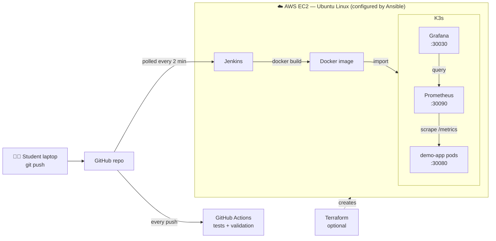

# 🚀 DEPI DevOps Demo — All the Tools in One Project

A small, working project that shows students how **Linux, Ansible, Terraform, Jenkins, AWS, Docker, K3s, Prometheus and Grafana** fit together.

> **The story:** you push code to GitHub ➜ CI tests it ➜ Jenkins builds a Docker image ➜ deploys it to Kubernetes (K3s) on an AWS server ➜ Prometheus collects metrics ➜ Grafana shows them on a dashboard.

---

## 🧭 Architecture



| Tool | Its job in this project | Where |
|---|---|---|
| **Linux** | The OS everything runs on (Ubuntu on EC2) | the server |
| **AWS** | Hosts the EC2 server | your AWS account |
| **Terraform** | *(Optional)* creates the EC2 + security group as code | `terraform/` |
| **Ansible** | Installs Docker, K3s, Jenkins and the monitoring stack with one command | `ansible/` |
| **Docker** | Packages the app into an image | `app/Dockerfile` |
| **K3s** | Lightweight Kubernetes that runs the app and monitoring | `k8s/` |
| **Jenkins** | CD: test ➜ build ➜ deploy on every push | `Jenkinsfile` |
| **GitHub Actions** | CI: tests + checks the IaC on every push (no server needed) | `.github/workflows/ci.yml` |
| **Prometheus** | Collects metrics from the app's `/metrics` | `k8s/monitoring/` |
| **Grafana** | Dashboard of the app's traffic and latency | `k8s/monitoring/config/` |

---

## 📁 Project structure

```
depi-devops-demo/
├── app/                    # Flask app (/ page, /api, /health, /metrics) + tests + Dockerfile
├── ansible/                # inventory.ini + site.yml + roles (common, docker, k3s, jenkins)
├── k8s/
│   ├── app/app.yaml        # Namespace, Deployment (2 replicas), NodePort Service
│   └── monitoring/         # Prometheus + Grafana (kustomize) + config files
├── terraform/              # OPTIONAL: create a new EC2 from scratch
├── scripts/check-tools.sh  # ✅/❌ for every tool on this machine
├── .github/workflows/ci.yml
├── Jenkinsfile
├── docker-compose.yml      # local version: app + Prometheus + Grafana
└── Makefile                # short commands (run `make help`)
```

---

## ✅ Step 0 — Check your tools

```bash
./scripts/check-tools.sh            # on your laptop
./scripts/check-tools.sh --server   # on the EC2, after deployment
```

**On your laptop you need:** Git, Docker, Ansible (Terraform and the AWS CLI only if you use the optional Terraform part).

macOS (Homebrew):
```bash
brew install git ansible terraform awscli gh
brew install --cask docker        # then open Docker Desktop
```
Ubuntu:
```bash
sudo apt update && sudo apt install -y git ansible docker.io python3-pip
```

**On the server you need nothing in advance.** Ansible installs Docker, K3s, Jenkins, Prometheus and Grafana for you.

---

## 💻 Part 1 — Test locally (your laptop)

```bash
make test        # unit tests (pytest)
make local-up    # app + Prometheus + Grafana in Docker Compose
```

| Open | URL |
|---|---|
| App | http://localhost:5000 (JSON: /api) |
| Health | http://localhost:5000/health |
| Metrics | http://localhost:5000/metrics |
| Prometheus | http://localhost:9090 → Status ➜ Targets: `demo-app` should be **UP** |
| Grafana | http://localhost:3000 (admin / admin) ➜ Dashboards ➜ *DEPI Demo* ➜ *DEPI Demo App* |

Generate some traffic so the graphs move:
```bash
for i in $(seq 1 200); do curl -s localhost:5000/ > /dev/null; done
```
Stop it with `make local-down`.

---

## ☁️ Part 2 — Deploy to your AWS server

### 2.1 Server requirements
- **Ubuntu 22.04 or 24.04** (the playbook uses the `ubuntu` user and `apt`)
- At least **t3.medium (2 vCPU / 4 GB RAM)** and a 20–30 GB disk. K3s + Jenkins + monitoring don't fit in a t2.micro.
- **Security group inbound rules** (TCP):

| Port | For |
|---|---|
| 22 | SSH / Ansible |
| 8080 | Jenkins |
| 30080 | Demo app |
| 30090 | Prometheus |
| 30030 | Grafana |

### 2.2 Point Ansible at the server
```bash
mv ~/Downloads/depi-test.pem ~/.ssh/      # wherever your key is
chmod 400 ~/.ssh/depi-test.pem
make server IP=<SERVER_PUBLIC_IP>         # writes the IP into ansible/inventory.ini
make ping                                 # expect: "ping": "pong"
```
> Key somewhere else? Edit `ansible_ssh_private_key_file` in `ansible/inventory.ini`.
> **Never commit the .pem.** `.gitignore` already blocks `*.pem`.

### 2.3 Install everything with one command
```bash
make deploy      # = cd ansible && ansible-playbook site.yml   (~5–10 min)
```
At the end it prints the URLs and the **Jenkins initial admin password**.

### 2.4 Set up Jenkins (one time, ~3 minutes)
1. Open `http://<SERVER_IP>:8080` and paste the initial admin password.
2. Click **Install suggested plugins**, then create your admin user.
3. **New Item** ➜ name `depi-demo` ➜ **Pipeline** ➜ OK.
4. Under *Pipeline*: **Definition** = *Pipeline script from SCM*, **SCM** = *Git*
   - Repository URL: `https://github.com/<YOUR_USER>/depi-devops-demo.git`
   - Branch: `*/main` · Script Path: `Jenkinsfile`
5. **Save** ➜ **Build Now**. The first build turns on the "check GitHub every 2 minutes" trigger.

> Private repo? Add a GitHub token under *Credentials* and select it in step 4.

When the build is green, open:
- App ➜ `http://<SERVER_IP>:30080` (shows the Jenkins build number) · JSON at `/api`
- Prometheus ➜ `http://<SERVER_IP>:30090` ➜ Status ➜ Targets
- Grafana ➜ `http://<SERVER_IP>:30030` (admin / admin) ➜ *DEPI Demo App*

---

## 🔁 Part 3 — The live demo: push ➜ pipeline ➜ students see it

**The idea:** you change code on your laptop and push. Jenkins on the server picks up the commit and redeploys. Students who have `http://<SERVER_IP>:30080` open see the new version. The page refreshes itself every 10 s, so they don't even have to reload.

1. Edit the two lines at the top of `app/app.py`:
   ```python
   MESSAGE = "Hello DEPI students - version 2! 🚀"
   BG_COLOR = "#065f46"   # green
   ```
2. Test locally first (optional but good practice):
   ```bash
   make test && make local-up      # check http://localhost:5000
   ```
3. Push:
   ```bash
   git add . && git commit -m "Change welcome message" && git push
   ```
4. Watch it happen:
   - **GitHub ➜ Actions tab:** CI runs tests, the Docker build and Terraform/Ansible/K8s checks (about 1–2 min).
   - **Jenkins (`:8080`):** picks up the commit within 2 minutes ➜ *Unit Tests ➜ Build ➜ Load into K3s ➜ Deploy ➜ Smoke Test*.
   - **Students' browsers (`:30080`):** new message and colour, new **version** (= Jenkins build number) and new pod name.
   - **Grafana (`:30030`):** traffic keeps flowing through the rolling update (zero downtime).

> ⚡ **Instant builds (optional):** in GitHub ➜ Settings ➜ Webhooks ➜ add `http://<SERVER_IP>:8080/github-webhook/` (content type `application/json`). In the Jenkins job tick **GitHub hook trigger for GITScm polling**.

**Break it on purpose (good lesson):** make a test fail and push. Both GitHub Actions and Jenkins stop at the test stage, and the running version stays up.

---

## 🧱 Optional — Create the server with Terraform

Use this when you want students to see Infrastructure as Code create the EC2 itself.

```bash
aws configure                                   # your AWS keys
cd terraform && cp terraform.tfvars.example terraform.tfvars   # edit region / key name
cd .. && make infra                             # creates EC2 + security group
make ping && make deploy                        # Terraform already wrote ansible/inventory.ini
make destroy                                    # ⚠️ delete it when finished to stop paying
```
Terraform uses your **existing** EC2 key pair `depi-test` (`key_name` variable) and the latest Ubuntu 24.04 image.

---

## 🛠️ Useful commands on the server

```bash
ssh -i ~/.ssh/depi-test.pem ubuntu@<SERVER_IP>
kubectl get nodes
kubectl get pods -A
kubectl -n demo get deploy,pods,svc
kubectl -n demo logs deploy/demo-app
kubectl -n demo rollout history deploy/demo-app
kubectl -n demo rollout undo deploy/demo-app   # roll back to the previous version
sudo systemctl status jenkins
```

## 🩺 Troubleshooting

| Problem | Fix |
|---|---|
| `make ping` times out | Port 22 closed in the security group, or wrong IP |
| `Permissions 0644 for depi-test.pem are too open` | `chmod 400 ~/.ssh/depi-test.pem` |
| `UNREACHABLE ... Permission denied (publickey)` | Wrong key, or the AMI isn't Ubuntu (user must be `ubuntu`) |
| Jenkins page doesn't open | Port 8080 closed; `sudo systemctl status jenkins` |
| Pods `ErrImageNeverPull` | The image wasn't imported. Run the Jenkins job (it builds and imports it). |
| Grafana dashboard empty | Hit the app a few times; check Prometheus ➜ Targets shows the pods UP |
| Jenkins doesn't trigger on push | Run **Build Now** once (that turns on polling) and wait up to 2 min |

## 🔐 Demo-only shortcuts (say this to students)
This is a teaching project, so some things are kept simple on purpose. In production you would:
- change the Grafana password `admin/admin` and use Secrets
- restrict the security group to your own IP (`allowed_cidr`)
- push images to a registry (ECR / Docker Hub) instead of importing them into K3s
- use Jenkins agents, credentials and HTTPS
- keep Terraform state in a remote S3 backend

---
**Author:** Mohamed Rahim · DEPI DevOps Track
