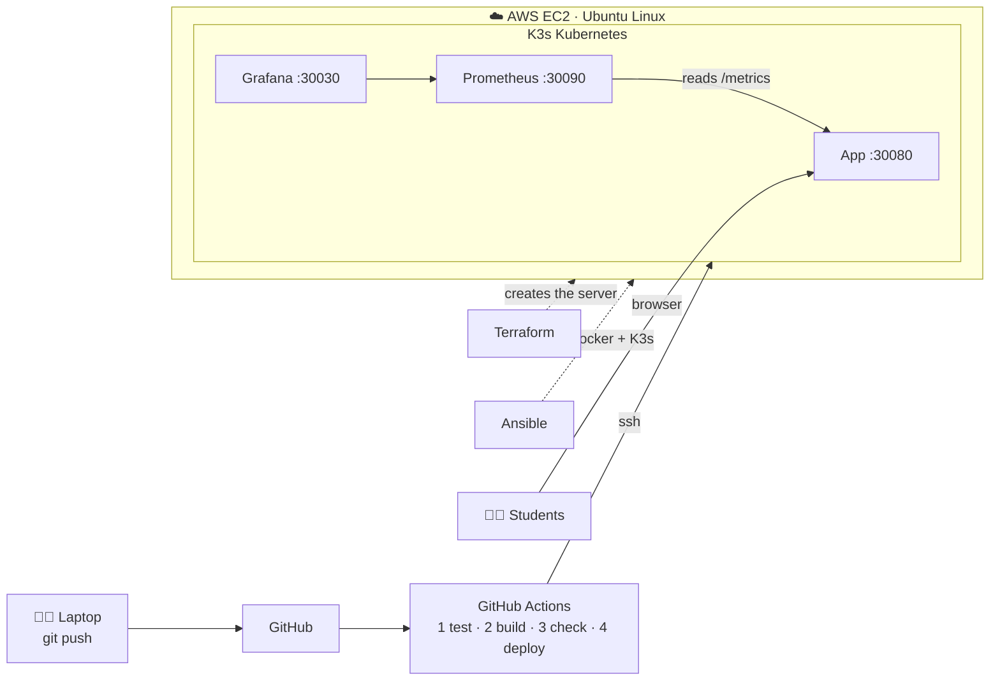

# 🚀 DEPI DevOps Demo

One small project that shows how **Linux, Terraform, AWS, Ansible, Docker, K3s, GitHub Actions, Prometheus and Grafana** work together.

> **The story:** change one line ➜ `git push` ➜ **GitHub Actions** tests, builds and deploys it to **K3s** on an **AWS** server ➜ students see the new version ➜ **Prometheus + Grafana** show the traffic.

> 🎓 **Teachers:** how to check it works, how to explain each tool, and a 45-minute live demo script are in [docs/TEACHING-GUIDE.md](docs/TEACHING-GUIDE.md).

## 🧭 Architecture



| Tool | Its job | File |
|---|---|---|
| Linux | The server's OS (Ubuntu 24.04) | — |
| AWS | Gives us the server (EC2) | — |
| Terraform | Creates the network (VPC, internet gateway, firewall) and the server with code | `terraform/` |
| Ansible | Installs everything on the server | `ansible/` |
| Docker | Packs the app into an image | `app/Dockerfile` |
| K3s | Small Kubernetes, runs 2 copies of the app | `k8s/` |
| GitHub Actions | CI/CD on every push | `.github/workflows/ci-cd.yml` |
| Prometheus | Collects the app's numbers | `k8s/monitoring/` |
| Grafana | Shows the numbers as graphs | `k8s/monitoring/config/` |

---

## 0️⃣ Install the tools (once)

```bash
brew install git gh terraform awscli
brew install --cask docker
```
Ansible (works on Intel and Apple Silicon Macs, about 1 minute):
```bash
python3 -m venv ~/.ansible-venv
~/.ansible-venv/bin/pip install --upgrade pip ansible-core
ln -sf ~/.ansible-venv/bin/ansible ~/.ansible-venv/bin/ansible-playbook /usr/local/bin/
```
> Why not `brew install ansible`? On Intel Macs Homebrew has no ready-made packages any more, so it compiles LLVM and Rust from source (hours).
Put `depi-test.pem` in `~/.ssh/` or `~/Downloads/`. Check with `make check`.

## 1️⃣ Try it on your laptop (free)

```bash
make test
make local-up
```
App http://localhost:5000 · Prometheus http://localhost:9090 · Grafana http://localhost:3000 (admin/admin).
Stop with `make local-down`.

## 2️⃣ Put it on AWS — one command

```bash
make all
```
It checks your tools, logs you in to GitHub and AWS, **shows the Terraform plan and asks "yes"**, creates the EC2, runs Ansible, sets the GitHub secret, pushes, and waits for the pipeline. It takes about 15 minutes and prints your links at the end:

| | |
|---|---|
| App | `http://<IP>:30080` |
| Prometheus | `http://<IP>:30090` |
| Grafana | `http://<IP>:30030` (admin / admin) |
| Pipeline | GitHub ➜ your repo ➜ **Actions** |

## 3️⃣ The live demo

1. Students open `http://<IP>:30080` (it refreshes every 10 s).
2. Edit the top of `app/app.py`:
   ```python
   MESSAGE = "Hello DEPI students - version 2! 🚀"
   BG_COLOR = "#065f46"
   ```
3. Push:
   ```bash
   git commit -am "New message" && git push
   ```
4. Watch **Actions**: 1 test ➜ 2 build ➜ 3 check ➜ 4 deploy (about 3–4 minutes).
5. The page changes colour and shows the new **version** (the run number).

💡 Make a test fail and push: the pipeline stops at step 1 and the old version stays online.

## 4️⃣ When you finish

```bash
make destroy
```
⚠️ The server costs money every hour until you do this.

---

## Commands

| Command | Does |
|---|---|
| `make all` | Everything |
| `make test` | Unit tests |
| `make local-up` / `make local-down` | Laptop version |
| `make configure` | Run Ansible again |
| `make ssh` | Log in to the server |
| `make status` | Show the pods |
| `make doctor` | Find why SSH / Ansible can't reach the server (changes nothing) |
| `make destroy` | Delete the server |

## If something goes wrong

| Problem | Fix |
|---|---|
| `brew install ansible` runs for hours | Stop it (Ctrl+C) and use the `pip` commands in step 0 |
| `InstanceType ... not eligible for Free Tier` | New AWS accounts on the Free plan can't start t3.medium. List allowed types: `aws ec2 describe-instance-types --filters Name=free-tier-eligible,Values=true --query "InstanceTypes[].[InstanceType,VCpuInfo.DefaultVCpus,MemoryInfo.SizeInMiB]" --output table`, pick one with 2 vCPU and 4 GB or more (e.g. `c7i-flex.large`), then `TF_VAR_instance_type=<type> make all` (it is remembered for later runs). Or upgrade the account to a paid plan. |
| Ansible: `connect to host ... port 22: Operation timed out` (old version) | Fixed in v2.1.0: Terraform now makes its own VPC with an internet route. `git pull`, then `make all`. |
| Still timing out | Run `make doctor` and read steps 4–9 (firewall rule for port 22, route to the internet, your network, the key). Then `make all` again. |
| `No AWS region` | `aws configure set region <your-region>` |
| Push of the workflow refused | `gh auth refresh -s workflow` |
| `Push refused` | `git pull --rebase origin main`, then `make all` |
| Ansible `Permission denied (publickey)` | The `depi-test` key in AWS is not your `.pem`. Use the matching file. |
| Terraform: `already exists` | An old server from an earlier try exists. Delete it in the AWS console, then `make all`. |
| Actions step 4 fails | `make status`, then `make ssh` and `sudo k3s kubectl -n demo describe pods` |
| Grafana empty | Open the app a few times, then check Prometheus ➜ Status ➜ Targets |

## Demo shortcuts (tell the students)
Real projects would also: use a real Grafana password, open ports only to your IP (`allowed_cidr`), push images to a registry (ECR), and keep Terraform state in S3.

*Optional:* `Jenkinsfile` + `install_jenkins: true` in `ansible/site.yml` shows the same pipeline in Jenkins (port 8080). Off by default.

---
**Author:** Mohamed Rahim · DEPI DevOps Track
