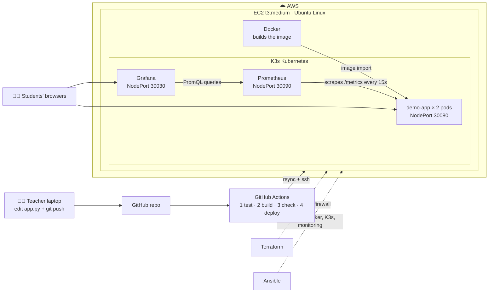

# 🎓 Teaching Guide: test it, explain it, demo it

Replace `<IP>` with your server IP. `make all` prints it at the end, and every green Actions run shows the links in its summary.

---

## 1. The architecture



Plain text version (for a whiteboard):

```
 laptop ──git push──► GitHub ──► GitHub Actions: test ► build ► check ► deploy
                                                                          │ ssh
 Terraform ─creates─►  ┌──────── AWS EC2 (Ubuntu Linux) ─────────┐ ◄─────┘
 Ansible ──installs─►  │  Docker builds image ─► K3s (Kubernetes) │
                       │     app pod  app pod   :30080  ◄──────────┼── students
                       │     Prometheus :30090 ─reads /metrics─►app│
                       │     Grafana    :30030 ─reads─► Prometheus │
                       └──────────────────────────────────────────┘
```

---

## 2. How to describe it to students (one sentence per tool)

| Tool | Say this |
|---|---|
| **Linux** | Every server in the cloud runs Linux. Ours is Ubuntu 24.04. |
| **AWS** | We rent a computer (EC2) by the hour instead of buying one. |
| **Terraform** | We *describe* the server in a file, and Terraform creates it. Same file = same server, every time. |
| **Ansible** | Terraform gives us an empty server. Ansible logs in by SSH and installs everything, so we never type it by hand. |
| **Docker** | Packs the app and everything it needs into one image that runs the same everywhere. |
| **K3s (Kubernetes)** | Runs our containers, keeps 2 copies alive, restarts them if they die, and updates them with zero downtime. |
| **GitHub Actions** | A robot that runs on every `git push`: test ➜ build ➜ check ➜ deploy. If a step fails, it stops. |
| **Prometheus** | Asks the app "how many requests? how fast?" every 15 seconds and stores the answers. |
| **Grafana** | Turns Prometheus' numbers into graphs. |

**What happens on one `git push`** (draw this as arrows):
1. GitHub receives the code.
2. Actions job 1 runs the unit tests (pytest).
3. Job 2 builds the Docker image and checks `/health`.
4. Job 3 checks the Terraform, Ansible and Kubernetes files.
5. Job 4 copies the code to the server, builds the image there, gives it to K3s, and K3s replaces the pods one by one (rolling update).
6. Job 4 checks that `http://<IP>:30080/api` shows the new version. If not, the run is red.
7. Students' pages refresh (every 10 s) and show the new message, colour and version.

**Key words to teach:** CI (test + build on every push), CD (deploy automatically), Infrastructure as Code, configuration management, container, pod, replica, rolling update, rollback, metrics, dashboard.

---

## 3. How to check that it works (after `make all`)

Do these in order. Each line says what you should see.

| # | Check | Command / where | You should see |
|---|---|---|---|
| 1 | Terraform made the server | `cd terraform && terraform output && cd ..` | `server_public_ip = "x.x.x.x"` |
| 2 | Server is in AWS | AWS console ➜ EC2 ➜ Instances | `depi-devops-demo-server` **Running** |
| 3 | Ansible finished | end of `make all` Ansible part | `PLAY RECAP ... failed=0` |
| 4 | All pods run | `make status` | 2 × `demo-app-…` in `demo`, `prometheus-…` and `grafana-…` in `monitoring`, all `Running` |
| 5 | Pipeline green | GitHub ➜ Actions ➜ latest run | 4 green jobs + a summary table with links |
| 6 | App is live | `curl http://<IP>:30080/api` | JSON with `"version":"<run number>"` |
| 7 | Health | `curl http://<IP>:30080/health` | `{"status":"ok", ...}` |
| 8 | Prometheus finds the app | `http://<IP>:30090` ➜ Status ➜ Targets | `kubernetes-pods` with **2/2 UP** |
| 9 | Prometheus has data | `http://<IP>:30090` ➜ query `up{app="demo-app"}` | two lines with value `1` |
| 10 | Grafana dashboard | `http://<IP>:30030` (admin/admin) ➜ Dashboards ➜ DEPI Demo ➜ DEPI Demo App | "Healthy app targets" = 2, graphs move after you send traffic |

If a check fails, see "If something goes wrong" in the README.

---

## 4. The live demo (about 45 minutes)

Before class: run `make all` (or check the server still runs with `make status`). Open 4 tabs: the app, GitHub Actions, Grafana, and your terminal.

### Scene 1 — Show the idea (5 min)
Draw the architecture above. Open the repo and show one folder per tool: `terraform/`, `ansible/`, `app/`, `k8s/`, `.github/workflows/ci-cd.yml`.

### Scene 2 — Test on the laptop first (5 min)
```bash
make test
make local-up
```
Open http://localhost:5000. Say: *"Always test locally before you push."* Then `make local-down`.

### Scene 3 — Show the infrastructure (5 min)
```bash
cd terraform && terraform output && cd ..
make status
```
Show the EC2 in the AWS console. Say: *"Terraform made this. Ansible set it up. Nobody clicked anything."*

### Scene 4 — Change the code live ⭐ (10 min)
Students open `http://<IP>:30080`. You edit the top of `app/app.py`:
```python
MESSAGE = "Hello DEPI students - version 2! 🚀"
BG_COLOR = "#065f46"   # green
```
```bash
git commit -am "Version 2: green" && git push
```
Show the Actions tab: jobs go green one by one (about 3–4 min). The students' page turns green and the version number goes up, without them pressing anything.

### Scene 5 — Break it on purpose (5 min)
The test checks that the API message contains "DEPI". Remove that word:
```python
MESSAGE = "Hello students"
```
```bash
git commit -am "Bad change" && git push
```
Job 1 turns **red** and nothing is deployed. The students' page stays on version 2. Say: *"This is why we test before we deploy."* Fix it back (put "DEPI" in the message) and push again.

### Scene 6 — Kubernetes heals itself (5 min)
`make ssh`, then:
```bash
sudo k3s kubectl -n demo get pods
sudo k3s kubectl -n demo delete pod <one-demo-app-pod-name>
sudo k3s kubectl -n demo get pods -w        # a new pod appears; Ctrl+C to stop
```
The site never goes down: the other pod keeps serving. "Served by pod" on the page shows which copy answered.

Scale up:
```bash
sudo k3s kubectl -n demo scale deploy/demo-app --replicas=4
sudo k3s kubectl -n demo get pods
```
(The next push sets it back to 2, because `k8s/app/app.yaml` says `replicas: 2`. Good lesson: *the file in Git is the truth*.)

### Scene 7 — Rollback (3 min)
```bash
sudo k3s kubectl -n demo rollout history deploy/demo-app
sudo k3s kubectl -n demo rollout undo deploy/demo-app
```
The page goes back to the previous version in a few seconds. Type `exit` to leave the server.

### Scene 8 — Monitoring (5 min)
Send traffic from your laptop:
```bash
for i in $(seq 1 500); do curl -s http://<IP>:30080/ > /dev/null; done
```
In Grafana, "Requests / sec" and "Total requests" go up. In Prometheus try:
`sum(rate(demo_app_requests_total[1m]))`. Show `http://<IP>:30080/metrics` and say: *"This text page is all Prometheus reads."*

### Scene 9 — Clean up (2 min)
```bash
make destroy
```
Type `yes`. Say: *"Cloud servers cost money every hour. Always destroy what you don't need."*

---

## 5. Student exercises

1. Change `BG_COLOR` and push. Which job number deploys it?
2. Add a new test in `app/tests/test_app.py` that checks `/health` returns `"ok"`. Push it.
3. Change `replicas: 2` to `3` in `k8s/app/app.yaml` and push. Check with `kubectl get pods`.
4. In Prometheus, write a query for requests to `/api` only.
5. Explain in your own words what happens between `git push` and the new page.
